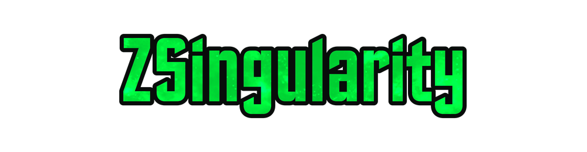
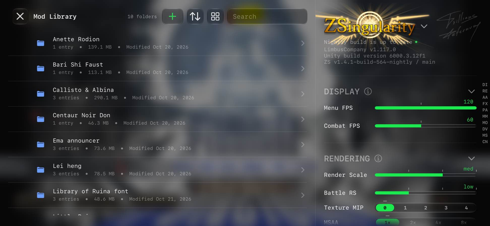
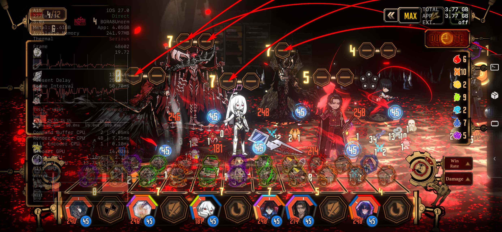
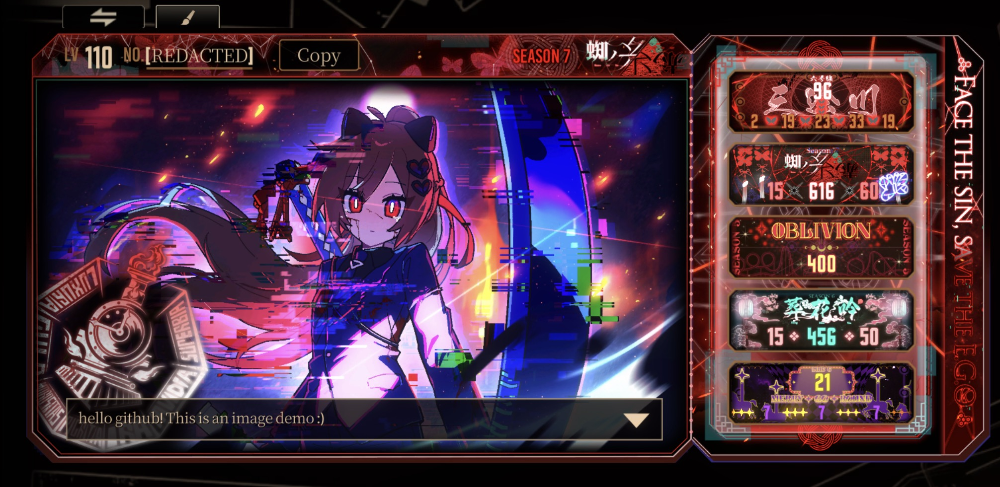

---
**ZSingularity** is a jailed iOS tweak for **Limbus Company** that unlocks several graphical settings, QoL features, visual mods and much more.

Need some help, have a bug to report or want to suggest new features? [Join the Discord Server!](https://discord.gg/nRmztE2unw)

>[!WARNING]
>ZSingularity is purely a cosmetic / performance mod ONLY, it will not and will never contain anything that might potentially give the player an in-game advantage.

>[!NOTE]
>ZSingularity is built for iOS only. **Android and Windows ports are not planned.**

  
  
  

## Features

### Graphical Settings

Tweak the game's visuals far beyond what its settings menu allows.

- **Framerate:** independent caps for menus and combat, unlock up to 120FPS of smooth gameplay on ProMotion devices
- **Render Scaling:** fine-grained resolution scaling control
- **Hidden Post FX:** bloom, motion blur, tonemapping, chromatic aberration, lens distortion, vignette, film grain, saturation and white balance
- **Hidden URP (Universal Render Pipeline) settings:** anti-aliasing mode & quality (FXAA, SMAA, TAA), MSAA, dithering, texture mip limit and memoryless render textures
- **Particle effects:** override render mode, alignment, sorting and size limits, cap particle counts, or turn them off entirely

### Memory Management

- **Bypass the memory usage limit** using `xpc_shmem`, bringing down the barrier to entry from iDevices with 6GB of ram down to just 3GB
- **Extensive memory usage analysis** to see exactly where your memory goes
- **One-tap memory cleanup** to free cached data the game no longer needs

### Visual Mods

- **Install & run every supported mod format:** `__data` Unity asset bundles, `.assets.bank` FMOD sound banks, `.carra2` and Lunartique formats
- Custom Unity asset bundles are processed on-device and re-targeted for iOS allowing Limbus to load them

### Custom Localization Manager

- **Support for custom translation mods**
- Brings the game's desktop-only Custom Localize Manager to iOS: ZSingularity patches the game so it reads language packs from the app's Documents folder in `NSDirectory/Documents/Lang/`

### Miscellaneous

- **Custom greeting text** on your player card
- **Hide UID** to keep it out of your screenshots and videos
- **Asset Explorer:** browse the game's asset bundles, sound banks and localization files, with a full-fledged **Texture2D & Sprite previewer**

## Installation

**Due to legal reasons, ZSingularity will no longer provide .ipa releases**

You may use [The web portal](https://vastrilliant.github.io/ZSingularity/) to embed ZSingularity onto your .ipa of LimbusCompany 

To install, **[SideStore](https://sidestore.io/)** is recommended, follow the steps provided in their Documentation

A PC is recommended for the smoothest installation process, otherwise you may use **[Sideinstaller](https://sideinstaller.net)** if you don't have a desktop environment (iOS27+ only)

> [!WARNING]
>Due to certain limitations and restrictions imposed by apple, you must acknowledge the following caveats that come with Sideloading:
>
>You will not be able to install updates from the AppStore, every time Limbus updates you’ll need to manually sideload the new version into your device 
>
>You won’t be able to make any app purchases in a sideloaded version of LimbusCompany
>
>You won’t be able to login to your limbus account thru Apple ID

## Legal, Liability & Usage Notice

ZSingularity is an independent, fan-made project and is **not affiliated with, endorsed by, or supported by Project Moon**. Limbus Company and all related assets are the property of their respective owners.

While no bans or account restrictions have been issued for visually modding the game or using similar tools, it is always best to be cautious.

This tweak modifies the game client's rendering and, via its mod loader, its asset bundles. Using it may violate Project Moon's Terms of Service, and any account-level consequences (including but not limited to warnings, restrictions, or bans) are **your own responsibility**. Use it at your own risk.

This software is provided **"as is," without warranty of any kind**, express or implied. The authors and contributors are not liable for any damages, data loss, account action, or other harm arising from the use or misuse of this tweak.
